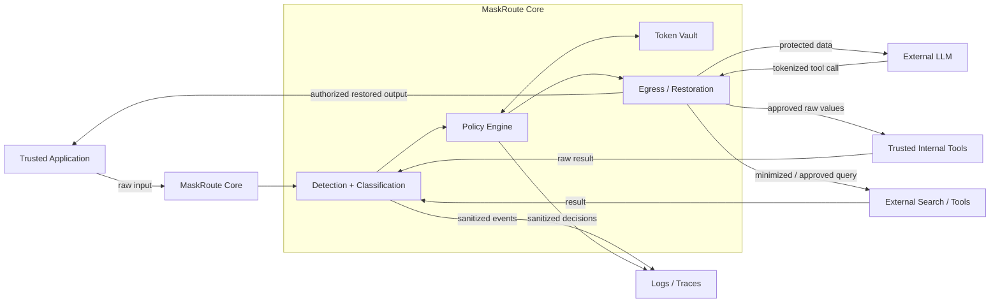

# MaskRoute — Trust Boundaries

## Trust zones

### Zone A — Trusted application

Contains:

- raw user/application input;
- authenticated user context;
- final authorized output.

### Zone B — MaskRoute core

Trusted security boundary.

Contains:

- detector pipeline;
- classification;
- policy engine;
- token vault;
- pseudonymization/restoration;
- egress checks;
- audit sanitization.

### Zone C — Trusted internal systems

Examples:

- CRM;
- internal APIs;
- internal databases;
- private search/indexes.

Raw values may be disclosed only when policy allows it.

### Zone D — External systems

Untrusted by default.

Examples:

- external LLMs;
- public web search;
- third-party AI APIs;
- external agent tools.

Only policy-approved data may cross into this zone.

---

## Main rule

Every transition from a trusted zone to an external zone is an **egress event** and must pass through MaskRoute policy enforcement.

---

## Core flows

### 1. LLM request

```text
Raw input
→ detect/classify
→ pseudonymize/redact/block
→ external LLM
```

### 2. Internal tool call

```text
LLM emits tokenized arguments
→ policy check
→ restore permitted values
→ trusted internal tool
```

### 3. External tool / web search

```text
LLM proposes tool call
→ policy check
→ minimize or block sensitive context
→ external tool
```

### 4. Tool response back to LLM

```text
Tool returns raw data
→ protect again
→ external LLM
```

### 5. Final application output

```text
LLM returns protected response
→ policy check
→ restore values allowed for the application/user
→ final output
```

### 6. Logs and traces

```text
Any component
→ sanitize
→ logging / telemetry
```

Raw sensitive values should not be logged by default.

---

## Architecture sketch



---

## Architecture constraints

- The LLM has no direct access to the token vault.
- External tools have no direct access to the token vault.
- Token restoration always requires a destination-aware policy check.
- Tool responses are treated as new input before crossing into an external zone.
- Logging is a separate egress destination with its own policy.
- Trust is configured per destination, not inferred from tool type alone.